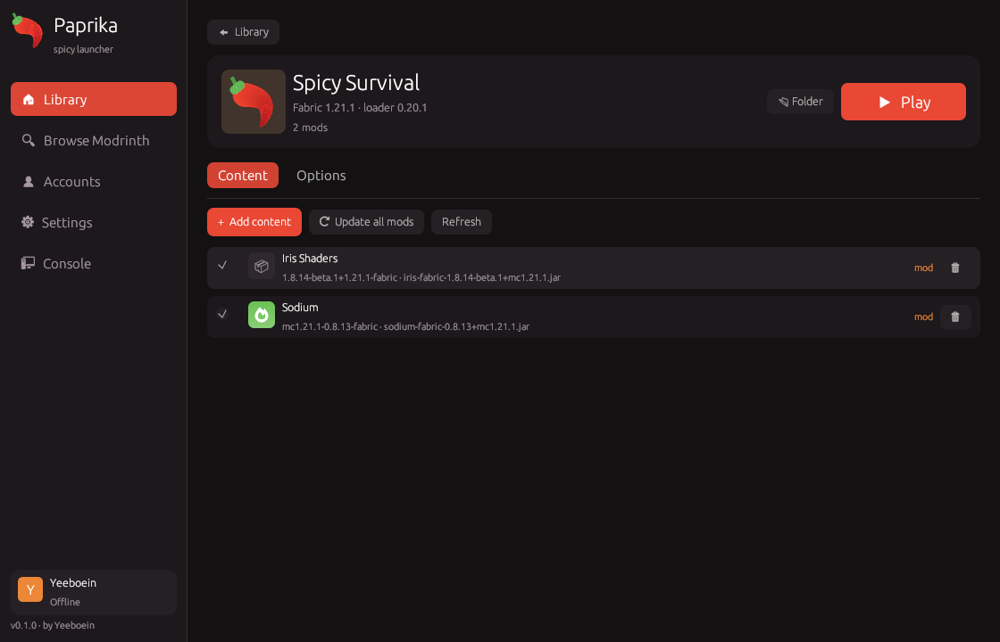

<p align="center">
  
</p>

<h1 align="center">Paprika Launcher</h1>
<p align="center"><b>A lightweight Minecraft launcher for Linux and Windows, with Modrinth built in.</b></p>
<p align="center">Made by <a href="https://github.com/yeeboein">Yeeboein</a></p>

---

Paprika Launcher is a small, fast Minecraft: Java Edition launcher. It's one native app (about 5–7 MB) with no Electron, no Java needed to run the launcher, and nothing to install first.

What makes it different: **Modrinth is part of the launcher.** Browse mods, modpacks, resource packs and shaders inside the app, click **Install**, and they go straight into your instance with their dependencies. You can add mods whenever you like, before or after you've started playing.


## Features

- 🌶️ **One-click Modrinth installs**: search, sort and install mods, resource packs and shaders straight into an instance. Results only show what works with that instance's Minecraft version and loader.
- 📦 **Automatic dependencies**: install Iris and Sodium comes with it.
- 🎁 **One-click modpacks**: install any Fabric/Quilt modpack from Modrinth and it becomes a ready-to-play instance.
- ⟳ **Update all mods** with one button (works for mods you added by hand too, as long as Modrinth knows them).
- 🧵 **Fabric and Quilt** loaders, plus vanilla, for any Minecraft version.
- ☕ **Java included**: Paprika downloads the exact Java runtime each Minecraft version needs, so you never install Java yourself.
- 👤 **Microsoft accounts** (device-code sign-in) and **offline accounts** for singleplayer/LAN.
- 🗂️ **Separate instances**, each with its own mods, worlds, settings and memory.
- ✅ Enable/disable or remove mods, open folders, rename and delete instances.
- 🖥️ Live game console.
- 🪶 Lightweight: a native Rust + egui app, and downloads are verified with SHA-1 and run in parallel.



## Download

Get the latest build from [**Releases**](https://github.com/yeeboein/paprika-launcher/releases):

| Platform | File |
|---|---|
| Windows (x64) | `paprika-windows-x86_64.exe` (just run it) or the `.zip` |
| Linux (x64) | `paprika-linux-x86_64.tar.gz` |

**Linux:** extract it and run the installer. It adds Paprika Launcher, with its icon, to your app menu (no root needed):

```bash
tar -xzf paprika-linux-x86_64.tar.gz && cd paprika && ./install.sh
```

Run `./install.sh uninstall` to remove it. Your worlds are kept.

## Build from source

You need [Rust](https://rustup.rs) (stable).

```bash
git clone https://github.com/yeeboein/paprika-launcher
cd paprika-launcher
cargo build --release
```

The app ends up in `target/release/paprika` (or `paprika.exe`). On Linux, run `./install.sh` to add it to your app menu with its icon.

Low on RAM (4 GB)? Build with lighter settings:

```bash
CARGO_PROFILE_RELEASE_LTO=thin CARGO_PROFILE_RELEASE_CODEGEN_UNITS=2 cargo build --release -j 2
```

## Microsoft sign-in setup

Microsoft login needs an Azure app "client ID". Every third-party launcher has its own:

1. Go to [portal.azure.com](https://portal.azure.com) → **App registrations** → **New registration**.
2. Supported account types: **Personal Microsoft accounts only**.
3. Open the app → **Authentication** → turn on **Allow public client flows**.
4. Copy the **Application (client) ID**.
5. New apps also need Minecraft API access: submit the app ID with [Mojang's review form](https://aka.ms/mce-reviewappid).
6. Paste the ID into **Paprika Launcher → Settings → Microsoft client ID**, or bake it into builds by setting the `PAPRIKA_MSA_CLIENT_ID` environment variable at build time. For GitHub builds, add a repository *variable* with that name.

Offline accounts work without any of this.

## Where files live

| OS | Folder |
|---|---|
| Linux | `~/.local/share/paprika` |
| Windows | `%APPDATA%\paprika` |

- **Portable mode:** put an empty `portable.txt` next to the executable and Paprika keeps everything in `paprika-data/` beside it (handy on a USB stick).
- Or set `PAPRIKA_HOME` to any folder.

## Releasing

Publish a release on GitHub (for example tag `v0.1.0`). The **Build** workflow builds Linux and Windows and attaches the files to that release.

## Roadmap

- Forge / NeoForge support
- Import instances from other launchers
- Mod changelogs & version picker
- Skin preview

## License

MIT © Yeeboein. See [LICENSE](LICENSE).

Paprika isn't an official Minecraft product and isn't approved by or associated with Mojang or Microsoft. Mod data comes from [Modrinth](https://modrinth.com).
